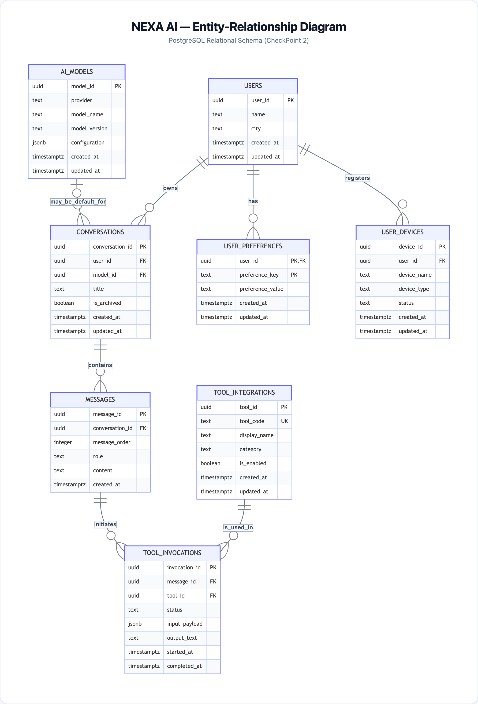
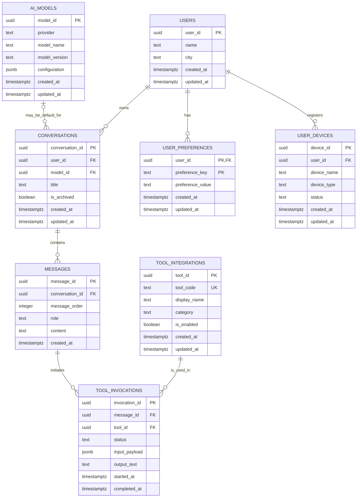

# Entity-Relationship (ER) Diagram for NEXA AI (CP2)

## 1. Visual Diagram

---

## 2. Overview

This document presents the Entity-Relationship (ER) model for the database-backed version of **NEXA AI**, corresponding to CheckPoint 2 (CP2). The relational schema is normalized to Boyce-Codd Normal Form (BCNF) / 3NF as detailed in `01_normalization.md`, and implemented in PostgreSQL in `03_schema.sql`.

The schema organizes the assistant's user profiles, conversations, messaging chronology, preferences, connected devices, model catalogue, and tool integration/invocation lifecycle into 8 core entities.

---

## 3. Entities and Attributes

| Entity | Attribute | Key Type | Data Type | Description |
|---|---|---|---|---|
| **`USERS`** | `user_id` | **PK** | `UUID` | Unique identifier for each user |
| | `name` | | `TEXT` | User display or profile name |
| | `city` | | `TEXT` | User location (optional) |
| | `created_at` | | `TIMESTAMPTZ` | Timestamp when user was registered |
| | `updated_at` | | `TIMESTAMPTZ` | Timestamp of last user update |
| **`AI_MODELS`** | `model_id` | **PK** | `UUID` | Unique model identifier |
| | `provider` | **UK (1/3)** | `TEXT` | Provider name (e.g., `'ollama'`) |
| | `model_name` | **UK (2/3)** | `TEXT` | Model family (e.g., `'llama3.2'`) |
| | `model_version` | **UK (3/3)** | `TEXT` | Tag or version string |
| | `configuration` | | `JSONB` | Provider options / hyperparameters |
| | `created_at` | | `TIMESTAMPTZ` | Creation timestamp |
| | `updated_at` | | `TIMESTAMPTZ` | Last update timestamp |
| **`CONVERSATIONS`**| `conversation_id`| **PK** | `UUID` | Unique chat session ID |
| | `user_id` | **FK** | `UUID` | References `USERS(user_id)` |
| | `model_id` | **FK** | `UUID` | References `AI_MODELS(model_id)` |
| | `title` | | `TEXT` | Conversation title |
| | `is_archived` | | `BOOLEAN` | Soft archival flag |
| | `created_at` | | `TIMESTAMPTZ` | Session start timestamp |
| | `updated_at` | | `TIMESTAMPTZ` | Session last activity timestamp |
| **`MESSAGES`** | `message_id` | **PK** | `UUID` | Unique message ID |
| | `conversation_id`| **FK, UK (1/2)**| `UUID` | References `CONVERSATIONS(conversation_id)` |
| | `message_order` | **UK (2/2)** | `INTEGER` | Strict 1-based order within conversation |
| | `role` | | `TEXT` | `'user'`, `'assistant'`, `'system'`, `'tool'` |
| | `content` | | `TEXT` | Message text content |
| | `created_at` | | `TIMESTAMPTZ` | Message timestamp |
| **`USER_PREFERENCES`** | `user_id` | **PK, FK** | `UUID` | References `USERS(user_id)` |
| | `preference_key` | **PK** | `TEXT` | Setting key (e.g., `'theme'`) |
| | `preference_value`| | `TEXT` | Setting value (e.g., `'dark'`) |
| | `created_at` | | `TIMESTAMPTZ` | Created timestamp |
| | `updated_at` | | `TIMESTAMPTZ` | Updated timestamp |
| **`USER_DEVICES`** | `device_id` | **PK** | `UUID` | Unique device identifier |
| | `user_id` | **FK** | `UUID` | References `USERS(user_id)` |
| | `device_name` | | `TEXT` | Friendly device name |
| | `device_type` | | `TEXT` | Device category / platform |
| | `status` | | `TEXT` | `'pending'`, `'connected'`, etc. |
| | `created_at` | | `TIMESTAMPTZ` | Registration timestamp |
| | `updated_at` | | `TIMESTAMPTZ` | Last update timestamp |
| **`TOOL_INTEGRATIONS`** | `tool_id` | **PK** | `UUID` | Unique tool identifier |
| | `tool_code` | **UK** | `TEXT` | Unique programmatic tool code |
| | `display_name` | | `TEXT` | Friendly tool name |
| | `category` | | `TEXT` | Category (e.g., `'weather'`) |
| | `is_enabled` | | `BOOLEAN` | Global tool availability flag |
| | `created_at` | | `TIMESTAMPTZ` | Created timestamp |
| | `updated_at` | | `TIMESTAMPTZ` | Updated timestamp |
| **`TOOL_INVOCATIONS`** | `invocation_id` | **PK** | `UUID` | Unique run identifier |
| | `message_id` | **FK** | `UUID` | References `MESSAGES(message_id)` |
| | `tool_id` | **FK** | `UUID` | References `TOOL_INTEGRATIONS(tool_id)` |
| | `status` | | `TEXT` | `'pending'`, `'succeeded'`, `'failed'` |
| | `input_payload` | | `JSONB` | Tool arguments / request parameters |
| | `output_text` | | `TEXT` | Tool response / stdout |
| | `started_at` | | `TIMESTAMPTZ` | Execution start timestamp |
| | `completed_at` | | `TIMESTAMPTZ` | Execution end timestamp |

---

## 4. Relationships and Cardinality

| Relationship | Cardinality | Parent Entity | Child Entity | Foreign Key | Delete Rule | Description |
|---|---|---|---|---|---|---|
| **owns** | `1 : 0..N` (`||--o{`) | `USERS` | `CONVERSATIONS` | `user_id` | `CASCADE` | A user can own 0 or more conversations; each conversation belongs to exactly 1 user. |
| **has** | `1 : 0..N` (`||--o{`) | `USERS` | `USER_PREFERENCES` | `user_id` | `CASCADE` | A user can have multiple named preferences. Composite PK `(user_id, preference_key)`. |
| **registers** | `1 : 0..N` (`||--o{`) | `USERS` | `USER_DEVICES` | `user_id` | `CASCADE` | A user can register multiple connected devices. |
| **may_be_default_for** | `0..1 : 0..N` (`o|--o{`) | `AI_MODELS` | `CONVERSATIONS` | `model_id` | `SET NULL` | A model may serve as default for conversations; if deleted, conversation remains (`SET NULL`). |
| **contains** | `1 : 0..N` (`||--o{`) | `CONVERSATIONS` | `MESSAGES` | `conversation_id` | `CASCADE` | A conversation contains ordered messages. Deleting chat purges all messages. |
| **initiates** | `1 : 0..N` (`||--o{`) | `MESSAGES` | `TOOL_INVOCATIONS` | `message_id` | `CASCADE` | A message can trigger 0 or more tool runs. Deleting message cascades to invocation logs. |
| **is_used_in** | `1 : 0..N` (`||--o{`) | `TOOL_INTEGRATIONS` | `TOOL_INVOCATIONS` | `tool_id` | `RESTRICT` | A tool cannot be deleted while invocation logs still reference it (`RESTRICT`). |

---

## 5. Compound Constraints and Business Rules

1. **Unique Model Identity:** `UNIQUE(provider, model_name, model_version)` in `AI_MODELS`.
2. **Conversation Ordering:** `UNIQUE(conversation_id, message_order)` in `MESSAGES` guarantees ordered sequence without gaps or collisions.
3. **Execution Timing:** `CHECK(completed_at IS NULL OR completed_at >= started_at)` in `TOOL_INVOCATIONS`.
4. **Valid Roles and Statuses:** 
   - `MESSAGES.role IN ('user', 'assistant', 'system', 'tool')`
   - `USER_DEVICES.status IN ('pending', 'connected', 'disconnected', 'revoked')`
   - `TOOL_INVOCATIONS.status IN ('pending', 'succeeded', 'failed', 'cancelled')`

---

## 6. Mermaid Diagram Source Code

